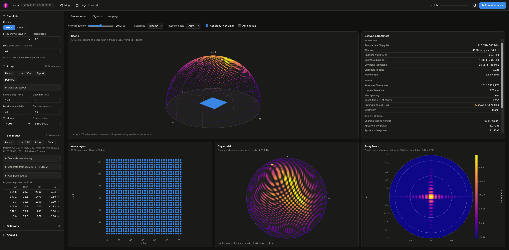

# fringe frontend

[github.com/samvandenende/fringe-frontend](https://github.com/samvandenende/fringe-frontend)

A browser-based environment for the [fringe](https://github.com/samvandenende/fringe) radio
interferometer simulator: configure the array, sky model and calibrators, run the real fringe
simulation on the CPU or GPU runtime, and inspect everything it produces — time-domain antenna
samples, spectra, waterfalls and beamformed sky images — next to the analytic expectation.



## Running

Requires Rust (same toolchain as fringe). fringe itself is a git dependency on
[github.com/samvandenende/fringe](https://github.com/samvandenende/fringe), pinned to a commit in
`Cargo.lock`; `cargo update -p fringe` moves to the latest commit.

```bash
cargo run --release
# fringe frontend running at http://127.0.0.1:8080
```

Options:

| Flag | Default | Description |
|------|---------|-------------|
| `--bind`, `-b` | `127.0.0.1:8080` | Address to serve on |
| `--web-dir` | `./web` | Static frontend directory |
| `--python` | `python3` | Interpreter for GSM2016 sky models (`pygdsm`, `healpy`, `astropy`) and user-written Python array layouts, calibrator trajectories and transmit buffers (`numpy`) |
| `--output-dir` | `./output` | Where runs that save data products write their HDF5 files |
| `--allow-remote-code` | off | Allow user-written Python code when bound to a non-loopback address (anyone who can reach the server can then run code as you) |

## Default environment

The frontend starts with a self-contained environment; *Default* in the Array and Sky model
sections restores it.

- **Array** (built in, `defaultArray()` in `web/js/model.js`): a 32 × 32 grid with 4 m spacing
  (0.4 λ at 30 MHz, 124 m across), 120 MHz sampling, no downmix, a 15–45 MHz bandpass,
  4096-sample windows and system noise k_B·T_sys = 1.38 × 10⁷ Jy m² (T_sys = 10⁴ K).
- **Sky model** (bundled, `web/data/default_sky.csv`): GSM2016 at NSIDE 32 in the lunar far-side
  frame at 2026-01-01T00:00 UTC, above the horizon only (6144 sources), with spectra fitted to
  third order (see [GSM2016 sky models](#gsm2016-sky-models)) over five maps from 15 to 45 MHz. At that epoch the site is in lunar night and the
  galactic anticentre is near the zenith. `web/data/default_sky.json` holds the generator's
  summary. It is generated rather than built in because GSM2016 needs Python and PyGDSM, which are
  optional; regenerate it with

  ```bash
  python3 scripts/gsm_sky.py --nside 32 --maps 5 --order 3 --fmin 15e6 --fmax 45e6 \
      --frame lunar-farside --epoch 2026-01-01T00:00:00 \
      --output web/data/default_sky.csv 2> >(grep '^SUMMARY ' | cut -c9- > web/data/default_sky.json)
  ```

Arrays and sky models in fringe's file formats (including fringe's own `examples/`) can still be
loaded with *Load JSON* / *Load CSV*.

## What you get

**Environment** — the simulation set-up, before anything runs:

- *Scene*: orbitable 3D view of the antenna array, the sky sources on the unit sphere and the
  calibrators, in fringe's local frame (z = zenith).
- *Array layout*, *sky model* (orthographic l/m projection, coloured by intrinsic or apparent
  flux density `z² · S(f)`) and the *array beam* (zenith-steered power pattern, showing grating
  lobes).
- *Spectral model*: expected per-bin power in Jy from sky sources, system noise
  (`k_B T_sys / A_eff`) and each calibrator (power flux density `z² P / 4πd²` spread over its
  transmit buffer's spectrum and filtered by the bandpass), exactly as fringe synthesises them.
- *Derived parameters*: sampling/channel resolution, baselines, angular resolution, aliasing
  limit, sky-to-noise ratio, data volume.

**Signals** — after a run:

- Run statistics (time per window, throughput, real-time factor).
- In-band power per antenna (click an antenna to inspect it).
- Complex time-domain samples of the last window, sample distribution vs Gaussian.
- Mean power spectrum per antenna and array-averaged, overlaid with the analytic model.
- Waterfall of array-averaged power per integration window.

**Imaging** — dirty images formed by beamforming the simulated E-fields at any imaging channel,
averaged over all integrations, compared with the *expected image* (sky model convolved with the
array pattern plus the noise floor) and the PSF.

**Outputs** — the latest run that saved data products (file, and each calibrator's TDOA residuals
and correlation SNR per integration) and all HDF5 files in the output directory, for download.

The sidebar edits everything fringe takes as input. Arrays, sky models and calibrators load from
and export to fringe's own file formats (`array.json`, `sources.csv`, a calibrators JSON with its
`.cf32` buffer files), so the
frontend doubles as an editor for CLI and Python inputs. Grid / random / ring layouts and random
skies can be generated in place.

### Units

The frontend uses fringe's units throughout:

| Quantity | Unit |
|---|---|
| Source flux density `reference_intensity` (sky model, *S₀*) | Jy (10⁻²⁶ W m⁻² Hz⁻¹) at `reference_frequency` |
| Source spectral indices `spectral_index`, `spectral_index_2`, `spectral_index_3` (*α₁*, *α₂*, *α₃*) | dimensionless: S(f) = S₀ · exp(α₁x + α₂x² + α₃x³), x = ln(f / f₀) |
| System noise `system_noise_intensity` | k_B·T_sys in Jy m² (1 Jy m² = 10⁻²⁶ W/Hz); the sidebar shows the equivalent T_sys |
| Transmitter power | EIRP in W, independent of the buffer's RMS |
| Antenna samples | √Jy: their mean power is the received flux density averaged over the sample frequency |
| Spectra, spectral model, *Over the timeline* powers | Jy per bin (received flux density, with the antenna gain z²) |
| Dirty and expected images | Jy (apparent flux density) |

The receiver noise is received as a flux density of `k_B T_sys / A_eff` with
`A_eff = min(λ²/4, 4 m²)`. A calibrator at distance d delivers a power flux density of
`z² P / (4π d²)` W/m², spread over its spectrum: a transmitter that is white over the array's
sample frequency f_s is received like a sky source of `z² P / (4π d² f_s) / 10⁻²⁶` Jy. Saved HDF5
files carry `units` attributes.

### Timelines: sky rotation and calibrator positions

Every run is a timeline of *Integrations* windows at UTC times: *Simulation → Start epoch* plus
*Interval* × the integration index (a blank interval runs the windows back to back). The
Environment tab's timeline bar plays or scrubs through the integrations; the scene, sky map, array
view, spectral model and derived parameters show the current one. When anything changes over the
timeline, an *Over the timeline* card charts the per-bin sky, noise and calibrator powers (at the
selected calibrator's carrier, or the band centre without one; calibrators on other carriers at
their own), each calibrator's elevation and the Doppler shift of its carrier.

1. **Sky rotation** (*Sky model → Over the timeline*):
   - *None*: the sky model stays fixed in the array frame.
   - *Lunar far side (ephemeris)*: an ICRS sky is rotated into the local frame at the centre of
     the lunar far side at each integration time (IAU/WGCCRE lunar orientation, ≈ 0.549 °/h).
   - *Constant rate about an axis*: the sky at the start epoch turns at a chosen rate about the
     local north axis (a site on the equator) or the zenith (a site at a pole). At the lunar
     sidereal rate about north this matches the ephemeris to < 0.01° over three days.

   The rotating sky is GSM2016 (all sky, generated at the chosen NSIDE) or the sidebar's sky model,
   read as ICRS RA/Dec for the ephemeris and as the sky at the start epoch for a constant rate.
   Sources below the horizon get zero flux density, so fringe neither sums emission from behind the
   Moon nor sees the source count change between windows.
2. **Calibrators**: a row of chips (*C1*, *C2*, …, *+ Add*) selects the calibrator the panel
   edits; each has its own colour in the views and charts, its own trajectory and its own
   transmitter. *+ Add* adds a kinematic calibrator 60 m from the array centre with the selected
   one's transmitter settings and its own noise buffer; *Remove* deletes the selected one (the
   others are renumbered). fringe simulates all of them together, up to 64. Each is *Off* (kept but
   not simulated), *Kinematic* or *Series*.
   - *Kinematic*: a position, velocity and acceleration at the start epoch (array frame); the
     calibrator then moves as `p + v·t + a·t²/2`. Presets: a drone hovering at 150 m, a low lunar
     orbiter overhead at the start (1.63 km/s with its centripetal acceleration) and a 550 km Earth
     satellite low in the sky.
   - *Series*: one state per integration, from a CSV/TSV whose header names `x`, `y`, `z` and
     optionally `vx`, `vy`, `vz`, `ax`, `ay`, `az` and `power` columns (other columns are ignored),
     or headerless rows of `x, y, z[, vx, vy, vz[, ax, ay, az]][, power]`:

     ```
     x,y,z,vx,vy,vz,power
     -200,50,150,10,0,0,
     -100,50,150,10,0,0,3e12
     ```

     Positions are metres relative to the array centroid or the array origin. Rows without a
     velocity get one from central differences of the positions over the integration times
     (*Estimate velocity*), so the Doppler shift follows the track; empty power cells use the
     power field. When the number of rows differs from the number of integrations, the frontend
     asks whether to set the integrations to the number of rows or drop the extra rows.
     *Python…* computes the series with a `positions(ctx)` function instead (see
     [Python functions](#python-functions)); it runs again whenever the integrations, interval or
     epoch change.

   *Switch calibrators off below the horizon, and skip integrations with none above* gives a
   calibrator zero power while it is below the horizon (fringe does not model occlusion) and
   leaves out the integrations with every calibrator below it (their timestamps stay as they
   are), which is useful when tracks span several orbits.

   *Load JSON + cf32* reads a fringe calibrators JSON with all its buffer files: the first
   calibrator replaces the selected one and the others are added after it. *Export* writes the
   kinematic calibrators that are on as one calibrators JSON, with one `.cf32` file per distinct
   buffer.

   Each calibrator's **transmitter** is configured like fringe's `Transmitter`, a software defined radio: a
   *carrier* frequency, a cyclic buffer of complex baseband samples played out at the *sample
   rate*, the equivalent isotropically radiated power (*EIRP*, W; fringe scales the buffer to it
   whatever its RMS, and the parts of its spectrum outside the filter bandwidth or the bandpass
   are lost; *Auto* sets it 10 dB above sky + noise per bin at closest approach), an optional reconstruction filter *bandwidth* and the *buffer
   start* time. The buffer is white noise, a BPSK m-sequence (PRN code, 31 to 4 194 303 chips),
   a linear chirp across the sample rate, a tone at the carrier, a `.cf32` file (raw interleaved
   little-endian float32 IQ, as fringe and most SDR tools write), or a Python `buffer(ctx)`
   function. *Fit to band* centres the carrier in the bandpass and sets the sample rate to its
   width. fringe computes the received signal from the exact light-time delay to every antenna, so
   it carries the carrier and code Doppler of a moving calibrator; each window starts at its time
   on the timeline, so the buffer and the Doppler shift stay continuous between integrations.

Runs whose sky or calibrators change over the timeline, that skip integrations or switch a
calibrator off, or that save data
products (*Analysis & output → Save to HDF5*; the Run button then reads *Run simulation & save*)
go through the pipeline endpoint. Without products a run only feeds the Signals and Imaging tabs,
which compare it with the analytic model of the sky at the middle integration.

3. **Data products**, written to `<output-dir>/<name>.h5`:

   | Dataset | Shape | Contents |
   |---|---|---|
   | `raw/samples` | (N, antennas, samples) complex64 | fringe's time-domain output |
   | `calibrators/<k>/tdoa/measured_s`, `expected_s` | (N, antennas) | delay of each antenna relative to the reference antenna (positive = later) for calibrator k: cross-correlation estimate and the light-time truth at the middle of the window (`(|cal − r_a| − |cal − r_ref|) / c` for a calibrator at rest); `measured_s` is NaN while the calibrator is switched off |
   | `calibrators/<k>/tdoa/snr` | (N, antennas) | correlation peak / median off-peak level |
   | `images/dirty` | (N, pixels, pixels) | per-integration dirty image, averaged over the bins in the chosen bandwidth |
   | `time/utc`, `time/offset_s` | (N) | timestamps of the integrations that ran |
   | `calibrators/<k>/position`, `velocity`, `acceleration`, `power` | (N, 3), (N, 3), (N, 3), (N) | calibrator k's state at the start of each integration window, in array coordinates (power 0 while switched off) |
   | `calibrators/<k>/transmitter/buffer` | (samples) complex64 | its transmit buffer; the group's attributes hold the carrier `frequency`, `sample_rate`, `bandwidth` (NaN = none) and `start_time` |
   | `sky/sources`, `sky/frame_basis` | (S, 7), (N, 3, 3) | the base sky and, when rotated, each integration's east/north/up vectors in the base frame (ICRS, or the array frame at the rotation epoch); the `sky_frame` attribute describes the rotation |
   | `array/positions` | (antennas, 3) | plus array, runtime and seed attributes |

   `calibrators` holds one group per calibrator that was on, `0`, `1`, … in sidebar order, with
   its `name` (*C1*, *C2*, …) as an attribute and the number of calibrators in `count`; it is
   absent without calibrators. Each calibrator's TDOAs correlate only the bins its transmitter
   can occupy (its carrier ± half the sample rate or filter bandwidth, within the bandpass), so
   calibrators in separate bands do not disturb each other; calibrators sharing a band bias each
   other's estimates. The transmit buffers and the window times are saved too, so absolute times
   of arrival can be estimated offline by correlating the raw samples with the known buffers.

### Python functions

*Array → Python…*, *Calibrators → Series → Python…* and *Waveform → Python buffer(ctx)* open an
editor for a small Python function
that the server runs, with a console for `print()` output and tracebacks and a preview of the
result. `numpy` (`np`) and `math` are preloaded, and each function's code is kept in the
browser's local storage.

*Array → Python…* opens an editor in which you write a `layout(ctx)` function that returns the
antenna positions in metres: an `(N, 2)` or `(N, 3)` array-like (z = 0 when omitted), or a list of
`{"x", "y", "z"}` dicts. `ctx` carries the current array settings — `sample_frequency`,
`downmix_frequency`, `bandpass`, `fmin`/`fmax` (sky band), `wavelength_min`/`wavelength_max`,
`sample_window_size`, `c` and the current `positions` — so layouts can be written in wavelengths
or derived from the current array. `numpy` (`np`) and `math` are preloaded; `print()` output and
tracebacks appear in the console, and the result is previewed (with spacing / grating-lobe
checks) before *Apply to array*. Examples cover λ/2 grids, hexagonal disks, random layouts with a
minimum spacing, spiral arms, rings, perturbing the current array and loading a file.

*Calibrators → Series → Python…* takes a `positions(ctx)` function that returns the selected
calibrator's state at each integration (array frame, relative to the centroid or origin as selected): an `(N, 3)`
array-like of positions in metres, or `(N, 4)` with a power column (`NaN` uses the power field),
or a dict `{"position": (N, 3), "velocity": (N, 3), "acceleration": (N, 3), "power": (N,)}` in
which all but `position` are optional, or a list of `{"x", "y", "z"[, "vx", "vy", "vz", "ax",
"ay", "az", "power"]}` dicts. `ctx` carries the timeline — `integrations`, `interval`, `offsets`
(seconds after the start epoch, one per integration), `epoch`, `epoch_unix` — plus `antennas`,
`centroid`, `origin`, `moon_radius`, `moon_gm`, `fmin`/`fmax`, the calibrator's carrier `frequency`
and `c`. Each series calibrator keeps its own code, re-run for its own context when the timeline
changes; the Python editor itself is shared between calibrators.
The preview plots the elevation, gives the Doppler range and checks the count against the
timeline. Examples cover a circular lunar orbit with its velocity and acceleration (altitude,
track azimuth and cross-track offset, overhead mid-timeline; long timelines cover several orbits),
a drone circling the array, a straight flyover that only transmits near the array, and resampling
a file.

*Waveform → Python buffer(ctx)* takes a `buffer(ctx)` function that returns the transmit buffer:
a 1-D array of complex samples (or real ones, or `(N, 2)` I and Q), at most 2²² samples. `ctx`
carries the transmitter (`sample_rate`, `frequency`, `bandwidth`, `power`, `start_time`) and the
array (`fmin`/`fmax`, `sample_frequency`, `downmix_frequency`, `window`, `window_duration`). The
preview shows the line spectrum, period, RMS and crest factor. Examples cover an oversampled Gold
code, QPSK with root-raised-cosine pulses, a comb of tones across the band, pulsed noise and
loading a `.cf32` file.

The function runs in your own Python (`--python`), so it can use any installed package and read
local files. Because that means executing code sent over HTTP, the endpoint only works when the
server listens on a loopback address (or with `--allow-remote-code`), only accepts requests whose
`Host` is localhost (against DNS rebinding), and only accepts JSON bodies (which other websites
cannot send cross-origin without a CORS preflight the server never grants). Each run is limited
to 60 s.

### GSM2016 sky models

*Sky model → Generate from GSM2016 (PyGDSM)* builds a sky from the
[PyGDSM](https://github.com/telegraphic/pygdsm) Global Sky Model 2016, one source per HEALPix
pixel (`pip install pygdsm`; the server detects it at start-up). Options:

- **NSIDE** of the output sky, **fit maps** (number of GSM maps, evenly spaced over the fit range,
  used to fit each pixel's spectrum), the **spectrum** fitted (power law, or 2nd or 3rd order;
  see below) and the **fit range** (defaults to the array's bandpass,
  floored at GSM2016's 10 MHz limit).
- **Frame** written as RA/Dec (fringe's zenith is Dec = +90°). The default, *lunar far side*, is
  the local east/north/up frame of an observer on the lunar equator at the centre of the far side
  (selenographic longitude 180°, latitude 0°) at the chosen **epoch** (UTC): x = east,
  y = north (lunar spin axis), z = zenith, so Dec is elevation. The site orientation comes from the
  IAU/WGCCRE 2009 lunar rotation model (including physical libration), so the zenith stays within
  ~8° of the anti-Earth direction and sweeps the ecliptic once per sidereal month. The default
  epoch, 2026-01-01T00:00 UTC, is lunar night at the site with the galactic anticentre near the
  zenith. Generation reports the zenith direction and the Sun and Earth elevations (neither is in
  the sky model). ICRS and galactic frames are also available.
- **Base maps**: GSM2016 low (NSIDE 64) or high (NSIDE 1024) resolution; *auto* uses low for NSIDE ≤ 8.
- Keep only Dec > 0 (fringe still sums sources below its horizon, with gain z²).

Maps are generated with `data_unit="MJysr"` and converted to Jansky per pixel
(`× 1e6 × 4π / N_pix`). fringe's log-polynomial spectrum ln S = ln S₀ + α₁x + α₂x² + α₃x³,
x = ln(f / f₀), is fitted per pixel by least squares, with f₀ at the geometric mean of the map
frequencies. The order defaults to 3 and is capped at maps − 1; order 1 is the power law used
before fringe had higher-order indices. Over the default 15–45 MHz, checked against GSM2016 at 31
frequencies, the third-order fit from five maps is within 1.1% rms of GSM (5% at the 99.9th
percentile) against 4% (45%) for a power law. GSM2016 has non-positive pixels at low frequencies;
those samples are left out of the fit, which drops to a lower order if too few remain, and pixels
with fewer than two positive samples get α = 0.
The generator is `scripts/gsm_sky.py`, which also works standalone:

```bash
python3 scripts/gsm_sky.py --nside 32 --maps 5 --order 3 --fmin 15e6 --fmax 45e6 \
    --frame lunar-farside --epoch 2026-01-01T00:00:00 --output sky.csv
```

## Architecture

```
src/
  main.rs       axum server: static files + JSON API, runs one simulation at a time
  job.rs        request validation (mirrors fringe's asserts) and the start/finish loop
  analysis.rs   per-window FFTs, spectra, waterfall, E-field store, dirty imaging
  gsm.rs        GSM2016 sky generation via the embedded scripts/gsm_sky.py
  pycode.rs     user-written Python functions via the embedded scripts/python_runner.py
  pipeline.rs   timeline runs and saved outputs: per-integration sky/calibrator, TDOA, images, HDF5
  lunar.rs      lunar far-side frame (IAU/WGCCRE 2009) and UTC parsing, shared with previews
scripts/
  gsm_sky.py    PyGDSM GSM2016 → fringe sources CSV (also usable standalone)
  python_runner.py  runs a user's layout(ctx), positions(ctx) or buffer(ctx) and validates the result
web/
  index.html, style.css
  js/main.js    state, sidebar bindings, run orchestration, tab rendering
  js/model.js   client-side replica of fringe's signal model and file formats
  js/plot.js    canvas line plots and heatmaps
  js/views.js   3D scene, array map, sky map
  js/worker.js  array patterns and expected images off the main thread
  js/editor.js  small Python code editor (highlighting, indentation, undo)
  js/pydialog.js Python function dialog (editor, console, preview) for layouts, trajectories and buffers
  js/layouts.js example layout functions
  js/calibrators.js example calibrator trajectory and transmit buffer functions
  js/transmitter.js transmitter settings, waveform generators, cf32 files and the received spectrum
  js/timeline.js integration times, sky rotation, calibrator series, the timeline bar and step state
  js/outputs.js  data products to save, and the Outputs tab
  data/default_sky.csv, default_sky.json   bundled default GSM2016 sky and its generator summary
```

The server links fringe directly and drives `Simulation::start`/`finish` in a pipelined loop, so
the analysis of one window overlaps simulation of the next. Raw samples never leave the server
(the default array produces 32 MB per window); it keeps per-antenna mean spectra, the last
window's samples and, for each integration, the E-field of every antenna at the imaging channels.

Spectra are normalised so that a stationary signal's expected power per bin equals the flux
density (Jy) fringe synthesises in it; images are normalised by `antennas²` so a point source peaks
at its apparent flux density. Both line up with the analytic model, which makes the frontend a quick check
of the simulator itself.

### API

| Method & path | Description |
|---|---|
| `GET /api/info` | Server version, thread count, availability of GSM2016 and Python code |
| `POST /api/pipeline/run` | Start a timeline run and/or one that saves products (`times`, `calibrators` = `[{ name?, transmitter, states: [{ position, velocity, acceleration, power }] }]` with one state per time for each calibrator, `sky_frame` = `fixed` / `lunar-farside` / `rotating`, `sky_rotation` = `{ epoch, axis, rate }` for `rotating`, `sources`, `products`, `output_name`, plus run settings) |
| `GET /api/pipeline/result` | Summary of the latest such run (file, TDOA residuals and SNR per calibrator, timings) |
| `GET /api/pipeline/outputs` | HDF5 files in the output directory |
| `GET /api/pipeline/files/{name}` | Download an output file (supports range requests) |
| `POST /api/python` | Run a user function (`kind` = `layout`, `calibrator` or `transmitter`, `code`, `context`) → `{ positions, velocity?, acceleration?, power?, stdout }`, `{ buffer, stdout }` (base64 cf32) or `{ error, stdout }` |
| `POST /api/sky/gsm` | GSM2016 sky model (`nside`, `maps`, `order` (1–3, default 3), `fmin`, `fmax`, `frame`, `epoch`, `resolution`, `above_horizon`) → `{ csv, summary }` |
| `POST /api/run` | Start a run (`runtime`, `frequency_resolution`, `rng_seed`, `integrations`, `array`, `sources`, `calibrators`, `analysis`); `sources` are rows of fringe's sources CSV as objects (`spectral_index_2` and `spectral_index_3` are optional and default to 0); `calibrators` is fringe's calibrators JSON with the buffers inline: `[{ name?, position, velocity, acceleration, transmitter: { frequency, sample_rate, power, bandwidth, start_time, buffer } }]`, `buffer` being base64 cf32 |
| `GET /api/run/status` | State, progress, elapsed time, error message |
| `POST /api/run/cancel` | Stop after the current window (partial results are kept) |
| `GET /api/run/summary` | Timings, mean spectrum, per-antenna power, waterfall, imaging channels |
| `GET /api/run/antenna/{i}` | Last-window samples and mean spectrum of one antenna |
| `GET /api/run/image?channel=&size=` | Dirty image at an imaging channel |
